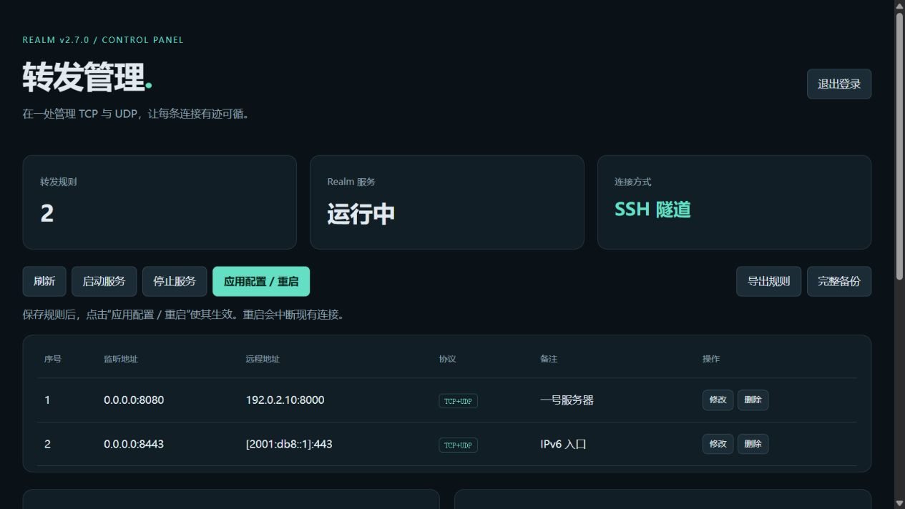

# EZRealm-Web

保留截图中 **Realm v2.7.0 中文 SSH 菜单 0–12**，新增 **13. Web管理面板**。SSH 与浏览器共用配置读写、输入校验、备份和冲突检测逻辑。



## 安装与使用

支持 **systemd Linux + Python 3.11 或更高版本**，推荐 Debian 12/13、Ubuntu 24.04。自动安装 Realm 二进制支持 x86_64 和 aarch64。管理脚本为 1.0.0，转发内核固定使用官方 v2.7.0。

```bash
# 如未安装 Python（Debian 12/13、Ubuntu 24.04）
apt-get update && apt-get install -y python3 ca-certificates wget

# 下载、检查并运行；请使用 root
wget -O realm.sh https://raw.githubusercontent.com/dearceline/EZRealm-Web/main/realm.sh
bash -n realm.sh
chmod +x realm.sh && ./realm.sh
```

脚本内置完整管理程序及固定版本的 TOML 库，无需在服务器安装 pip、Node.js 或编译环境。下载使用 HTTPS 证书验证；不使用 `--no-check-certificate` 或第三方下载代理。新装 Realm 时，从官方发布页下载 v2.7.0 及其 SHA256 校验文件，验证后安装。

首次使用：菜单 **1** 安装 Realm → **2/12** 添加或导入规则 → **6** 启动。以后运行 `ezrealm` 即可打开菜单；保存的规则在下一次启动/重启后生效。

### 原菜单编号

| 编号 | 操作 |
| --- | --- |
| 0 | 退出脚本 |
| 1 | 安装 Realm（已有服务不替换） |
| 2 | 添加 Realm 转发规则 |
| 3 | 查看 Realm 转发规则 |
| 4 | 修改 Realm 转发规则 |
| 5 | 删除 Realm 转发规则 |
| 6 | 启动 Realm 服务 |
| 7 | 停止 Realm 服务 |
| 8 | 重启 Realm 服务 |
| 9 | 卸载 Realm（保留配置和备份） |
| 10 | 定时重启任务 |
| 11 | 导出转发规则 / 完整配置 |
| 12 | 导入转发规则，Ctrl+D 结束 |
| 13 | Web管理面板：启动、停止、账号设置、连接方法 |

菜单 9 删除本项目安装的 Realm 服务和经安装记录核对的二进制；其他脚本安装的服务只停止和禁用，保留原安装文件。菜单 10 使用独立 systemd timer，按**服务器时区**每日重启，仅重启运行中的服务，不更改原有 cron。

## 12. 导入转发规则

进入选项 12 后，直接粘贴多行：

```text
1|8080|192.168.1.1:8000|一号服务器
2|8443|192.168.1.2:9000|二号服务器
3|9000|[2001:db8::1]:8080|IPv6服务器
```

格式严格为 **`序号|本地端口|远程IP:端口|备注`**，四列缺一不可，空备注仍保留最后一个 `|`。粘贴最后一行后按回车，再按 **Ctrl+D**；使用标准输入 EOF，不需要输入结束标记。若最后一行没有换行，终端可能需要再按一次 Ctrl+D。空行忽略。

- 序号为正整数，仅用于来源显示；导入后按配置顺序重新编号。
- 端口范围 1–65535；IPv6 必须写成 `[IPv6]:端口`，也接受远程域名。
- 导入规则以 `0.0.0.0:本地端口` 监听，协议为 **TCP + UDP**，与四列格式的默认行为一致。
- 备注保留中文、引号、空格，包括首尾空格；不接受控制字符、换行或 `|`，最多 512 字符。
- 与现有规则及本次已经接受的记录比较：相同监听地址、远程目标和协议记为重复；同端口有协议重叠记为冲突（失败），不会覆盖原规则。为避免双栈通配监听冲突，端口判断采用保守策略。
- 每行报告原因，分别统计成功、重复、失败。合法行追加保存，错误行跳过；没有成功行时不改动配置。
- 单批上限 1 MiB；修改前自动备份，单次保存采用原子替换。

也可通过文件/管道导入：

```bash
ezrealm --import rules.txt
cat rules.txt | ezrealm --import -
```

## 13. Web管理面板

菜单 13 → 1，首次启用时设置用户名和**至少 12 字符**的密码，无默认密码。支持查看、添加、修改、删除 TCP/UDP 转发、批量导入、导出、服务启停及应用配置。

面板仅监听服务器 `127.0.0.1:8765`。在自己电脑的终端建立隧道：

```bash
ssh -N -L 8765:127.0.0.1:8765 root@你的服务器地址
```

然后访问 **[http://127.0.0.1:8765](http://127.0.0.1:8765)**。隧道保持运行，不需要对公网开放 8765 端口。如果电脑的 8765 已占用，可使用 `-L 18765:127.0.0.1:8765`，浏览器访问 `http://127.0.0.1:18765`。

保存后点击“应用配置 / 重启”。重启会中断已有转发连接。失败会恢复上次成功应用的配置，并尝试恢复服务；失败版本另存备份。首次管理已有服务时，以第一次编辑前的文件作为恢复基线。

安全设计：scrypt 密码哈希、随机会话（30 分钟）、HttpOnly / SameSite=Strict Cookie、CSRF Token、Origin/Host 校验、登录限流、CSP。浏览器界面以专用非 root 账号运行，通过本机 Unix socket 向独立代理提交固定的配置/服务操作；代理不接受任意命令、路径或服务名。传输加密由 SSH 隧道提供。详见 [安全说明](SECURITY.md)。

## 现有配置与迁移

首次运行会优先读取现有 `realm.service` 的 `ExecStart` 中的 `-c/--config`。只自动接管**单个绝对路径的 TOML/JSON 文件**。读取配置不改写文件，已有服务和二进制不被替换。配置中的日志、DNS、传输层、负载均衡和其他字段保留；修改一条规则只改变对应监听、目标、备注和 TCP/UDP 开关。

没有可识别服务时，会检查常见配置路径。发现多个配置、目录配置、特殊启动器或无法解析的旧格式，会停止自动接管，保留原文件。首次可以明确指定：

```bash
bash realm.sh --config /实际位置/config.toml
```

这只指定管理的文件，不重写已有服务的启动参数。请确认该文件就是实际服务使用的配置。若服务使用多个 `-c` 文件或配置目录，请先人工整理为一个文件；不要指定一个与实际服务无关的文件。

本项目按截图及官方 v2.7.0 配置格式重新实现。用户提供的 [Gist 固定版本](https://gist.githubusercontent.com/ridaiqianhe/cf516fc8182035c7cabfbe80fab163db/raw/af8e8791893dd6457cbec1dfa45fb7a313ad50cc/realm.sh) 和 Gist 页面在 2026-11-07 返回 404，因此无法声称逐行延续原脚本，也无法核实原脚本私有元数据格式。常用 `remark/remarks/note/name` 备注字段及 `# 备注:` / `# note:` 注释可读取。未知的旧格式不会被静默转换；如需该 Gist 的逐项差异核对，需取得原文件。

### 导出与恢复

菜单 11 支持四列文本和完整配置；Web 面板也分别提供“导出规则”和“完整备份”。四列文本**不包含监听 IP、协议、传输参数、DNS 或负载均衡**，仅适合原截图格式的规则迁移；完整迁移和恢复请导出完整配置。

```bash
ezrealm --export rules.txt
ezrealm --export config-backup.toml --full  # JSON 原配置请用 .json 扩展名
```

完整配置按原格式导出，输出到已有文件会拒绝覆盖。自动备份保存在 `/var/lib/ezrealm-web/backups/`，不自动清理。恢复步骤见 [运维与恢复](docs/operations.md)。

## 项目开发与测试

```bash
python -m venv .venv
. .venv/bin/activate
python -m pip install -e .
python -m unittest discover -s tests -v
python tools/build_bundle.py
bash -n realm.sh
node --check ezrealm/static/app.js
```

设置 `REALM_BINARY=/绝对路径/realm` 后，测试会实际执行官方 Realm，验证 TCP/UDP、单协议、IPv6、带备注的 TOML/JSON。Linux 额外运行真实 PTY 的 Ctrl+D 测试。GitHub Actions 还在一次性 Ubuntu runner 上验证 systemd 安装、旧配置保留、管道 EOF、非 root 面板、代理写入和升级。未设置二进制时真实转发测试会明确跳过。

`realm.sh` 是确定性生成文件，包含源程序及 `tomlkit==0.13.3`，更改代码后必须重建。固定内置载荷哈希用于检测损坏；它不替代对下载来源的信任。完整验证说明见 [测试说明](docs/testing.md)。

## 来源与许可

管理程序使用 MIT 许可。Realm 内核来自 [zhboner/realm 官方 v2.7.0](https://github.com/zhboner/realm/releases/tag/v2.7.0)，遵循其自身 MIT 许可；未在本仓库分发内核二进制。配置依据 [官方 v2.7.0 文档](https://github.com/zhboner/realm/blob/v2.7.0/readme.md)。内置 tomlkit 0.13.3 的原始 MIT 声明保留在安装载荷的 `TOMLKIT-LICENSE` 中。
